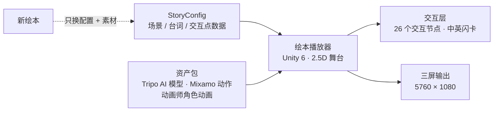

# 《拔萝卜》Unity 三投影互动绘本

> **An interactive children's picture book for a 3-projector 5760×1080 wall**, built in Unity 6 with a config-driven, reusable player.
>
> 本仓库为作品展示。源码见 [Turnip_Unity6_URP](https://github.com/lxue5947-sudo/Turnip_Unity6_URP)。

## 项目概览

| | |
| --- | --- |
| **客户** | 儿童互动教育内容（客户委托，已交付） |
| **时间** | 2026.05 – 2026.06 |
| **我的角色** | 独立负责：需求对接 → 交互设计 → Unity 开发 → 测试 → 交付；角色动画外包给动画师，由我制定规范并验收 |
| **显示** | 三投影拼接，5760×1080 |
| **技术栈** | Unity 6 · URP · C# · Tripo AI · Mixamo |
| **规模** | 26 个交互节点 |

## 架构：配置驱动的可复用播放器

## 关键设计

### 1. 数据驱动，一套播放器做多本绘本
场景内容由 `StoryConfig` 配置驱动。做新绘本时**只换素材和配置数据**，播放器代码直接复用。

### 2. 三投影多屏输出
基于 Unity 多显示器方案，适配 5760×1080 的三投影拼接画面。

### 3. AI 资产管线
Tripo AI 生成 3D 模型、Mixamo 提供动作，快速产出原型资产；角色精细动画由外包动画师完成，我负责制定规范和验收。

### 4. 生产规范沉淀
用 `CLAUDE.md` 记录资源管线、2.5D 舞台、UI 卡片布局等已验证的技术决策，配合 AI 编程工具在后续绘本中复用；交付时附流程文档和 26 步交互表。

---

作者：薛李锐 (Leo) · lxue5947@gmail.com · [GitHub 主页](https://github.com/lxue5947-sudo)
